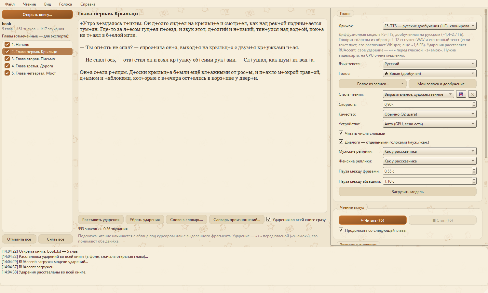
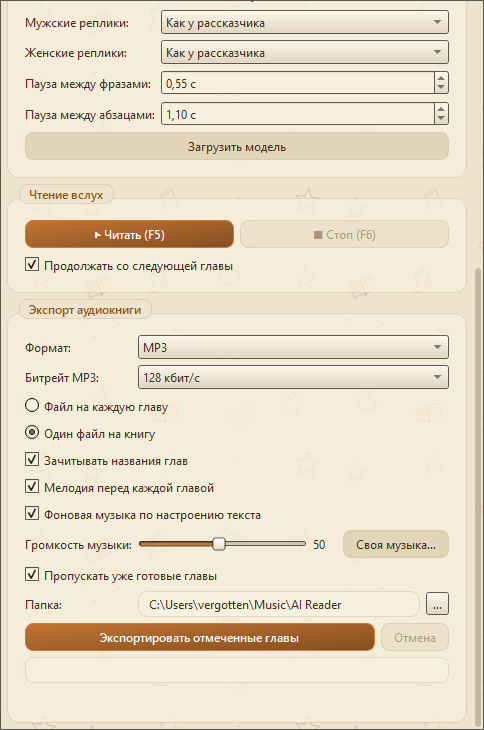
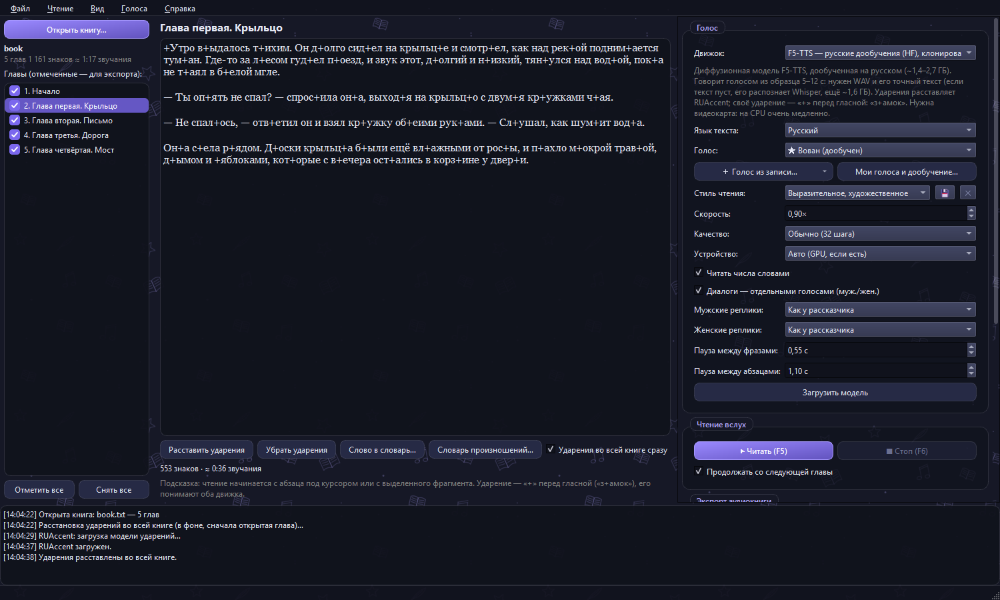
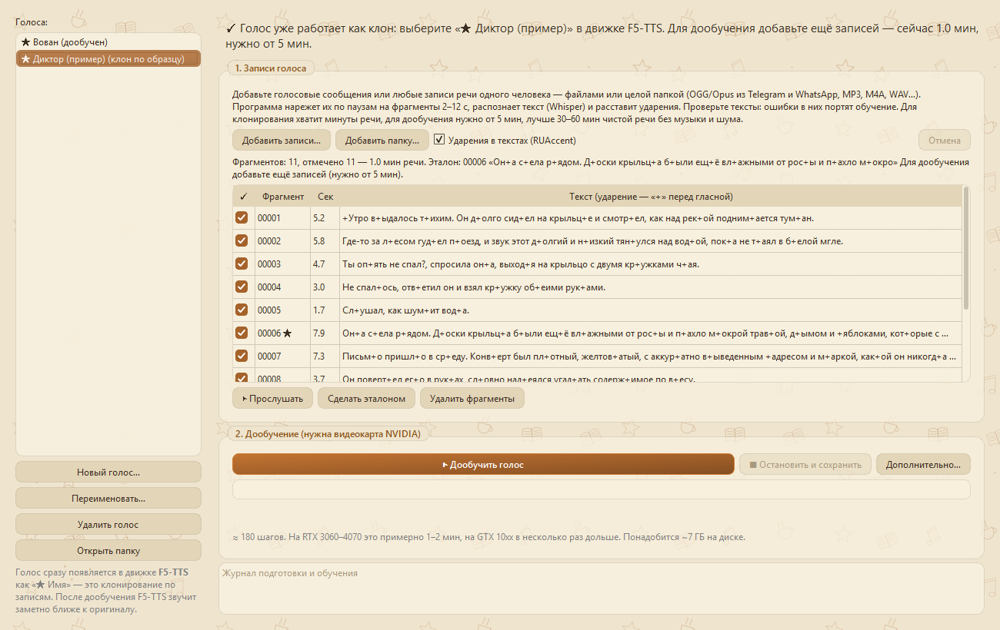

<p align="center"></p>

<h1 align="center">AI Reader</h1>

<p align="center"><b>Озвучка книг нейросетями · Neural audiobook maker for Russian</b></p>

<p align="center"><a href="#in-english">English summary ↓</a></p>



Программа для озвучки книг нейросетями. Открываете книгу, проверяете текст и ударения, слушаете прямо в программе или сохраняете аудиокнигу — по файлу на каждую главу. Сделана в первую очередь для русского языка.

- **Книги:** TXT (UTF-8/CP1251/KOI8 определяется сам), FB2 / FB2.zip, EPUB 2/3, PDF (с текстовым слоем), HTML. Главы находятся автоматически.
- **Просмотр:** список глав и редактируемый текст. Можно поправить слово или поставить ударение до озвучки.
- **Чтение вслух:** подсвечивается читаемый фрагмент, F5 — пуск/пауза, F6 — стоп, после главы продолжает следующую.
- **Экспорт:** MP3, OGG Vorbis, Opus, FLAC, WAV. Файл на каждую главу или один на всю книгу, с тегами (название, автор, альбом, номер трека).
- **Ударения:** нейросеть RUAccent, ручные ударения знаком «+» и словарь произношений.
- **Свой голос:** из голосовых сообщений и любых записей речи, с дообучением F5-TTS.

## Что нового (по отзывам после прослушивания)

- **Английские слова и аббревиатуры больше не пропадают.** Раньше русские голоса молча выбрасывали латиницу («бывший рефери NFL» → «бывший рефери»). Теперь «NFL» читается «эн эф эл», «Rich Dad» — «Рич Дэд». Если слово прочитано неудачно, добавьте его в словарь произношений.
- **Не тараторит.** Пауза теперь ставится после *каждого* предложения (раньше — только между большими кусками текста), после вопроса и «…» — чуть длиннее. Собственную тишину движка программа обрезает, поэтому слышны ровно те паузы, что выставлены. Стили чтения стали спокойнее; по умолчанию — «Выразительное, художественное».
- **Настройки больше не сбрасываются.** Всё сохраняется сразу при изменении, а не только при закрытии окна (раньше после перезагрузки компьютера с программой в трее всё возвращалось к умолчаниям). Удачный набор скорости и пауз можно сохранить как свой стиль кнопкой 💾.
- **Диалоги разными голосами.** Галочка «Диалоги — отдельными голосами»: реплики после тире читает мужской или женский голос, слова автора — рассказчик. Пол определяется по словам автора («сказала», «ответил», «она»).
- **Один файл на книгу — по умолчанию**, с метками глав внутри (MP3, OGG, Opus, FLAC): на телефоне книга не перемешается с музыкой, плеер помнит место, по главам можно переходить.
- **Мелодия перед главой** — одна и та же короткая мелодия перед каждой главой, затем название главы и текст, как в профессиональных аудиокнигах.
- **Фоновая музыка по настроению текста** — тихий эмбиент под чтение: программа угадывает настроение каждой части главы (спокойное, светлое, грустное, напряжённое, загадочное, нежное) и подбирает музыку; под голосом она тише, в паузах чуть громче. Свою музыку можно положить в папку настроения (кнопка «Своя музыка…»).
- **Всё включено сразу:** мелодия перед главой, фоновая музыка, диалоги разными голосами и ударения RUAccent включены по умолчанию; каждую галочку можно снять.
- **Голос из папки записей:** «＋ Голос из записи…» → «Вся папка с записями…» (или перетащите папку в окно) — берутся все подходящие файлы, с подпапками. Подготовка идёт в отдельном процессе: окно не зависает, а после неё программа предлагает сразу дообучить голос.
- **Только лучшие движки:** Silero (лёгкий, без видеокарты) и F5-TTS (клонирование и дообучение). Оба понимают ударения «+»; Piper, MMS и XTTS-v2, которые ставили ударения сами и часто ошибались, убраны.
- **Хороший движок сразу:** если есть видеокарта NVIDIA, по умолчанию выбран F5-TTS с дообученным голосом «★ Вован (дообучен)» — он входит в полный установщик и при первом запуске добавляется в «Мои голоса». Без видеокарты по умолчанию Silero: F5-TTS на процессоре слишком медленный.
- **Ударения во всей книге сразу:** после открытия книги RUAccent в фоне расставляет «+» во всех главах — их видно в тексте и можно поправить до озвучки (галочка «Ударения во всей книге сразу», включена по умолчанию).
- **Меньше памяти:** Silero в режиме «Авто» работает на процессоре (видеокарта ему не нужна), RUAccent загружается без большого словаря — вместе это около 1,5 ГБ памяти.
- **Новые темы оформления ✦** с книгами, нотами и наушниками на фоне; по умолчанию — светлая тёплая «✦ Медовая бумага» (кремовый фон, не белый), тёмная — «✦ Полночь».
- **Пропустить предисловия:** правый щелчок по главе → «Отметить с этой главы до конца».
- **Установка в один щелчок:** RUAccent (ударения нейросетью) и пакеты для голоса из записей ставятся прямо из программы, без командной строки.

## Запуск (Windows)

### 1. Установите uv (один раз)

[uv](https://docs.astral.sh/uv/) скачивает нужный Python и все библиотеки сам. Откройте PowerShell и выполните:

```powershell
powershell -ExecutionPolicy ByPass -c "irm https://astral.sh/uv/install.ps1 | iex"
```

После установки закройте и снова откройте окно PowerShell.

### 2. Установите программу (один раз и после обновлений)

```powershell
cd F:\Code\ai-reader
uv sync --extra all
```

Скачается около 3–5 ГБ (PyTorch с поддержкой видеокарт и движки озвучки). Если нужны не все движки, ставьте только нужные, например: `uv sync --extra silero --extra stress`.

### 3. Запустите

Дважды щёлкните **`run.bat`** или выполните в PowerShell:

```powershell
cd F:\Code\ai-reader
uv run ai-reader
```

Можно сразу открыть книгу: `uv run ai-reader "D:\Книги\Мастер и Маргарита.fb2"`, или перетащить файл книги в окно.

Чтобы программа ничего не скачивала во время работы, один раз скачайте все модели (~7 ГБ) в папку `models`: дважды щёлкните **`download-models.bat`** (или `uv run python -m ai_reader.fetch_models`). Уже скачанное пропускается. Без этого каждая модель скачается сама при первом использовании.

## Запуск в WSL (Ubuntu)

Окно программы показывается через WSLg (Windows 11 или Windows 10 после `wsl --update`), видеокарта работает через обычный драйвер NVIDIA для Windows. Окружение Python ставится в домашнюю папку WSL (`~/.venvs/ai-reader`): из `/mnt/f` библиотеки грузились бы очень медленно, а `.venv` в папке проекта — это окружение для Windows, его не трогаем.

```bash
cd /mnt/f/Code/ai-reader
bash setup-wsl.sh     # один раз: системные библиотеки (спросит пароль sudo), uv и все пакеты
bash run.sh           # запуск
```

Книгу можно указать путём WSL или Windows — программа переведёт путь сама:

- `bash run.sh "D:\Книги\книга.fb2"` или `bash run.sh "/mnt/d/Книги/книга.fb2"`;
- **Файл → Открыть по пути…** (Ctrl+Shift+O): вставьте путь из Проводника (Shift + правый щелчок по файлу → «Копировать как путь»);
- в окне «Открыть книгу…» диски Windows (`/mnt/c`, `/mnt/d`…) есть на боковой панели;
- **из Проводника:** перетащите книгу на `ai-reader-wsl.bat` в папке проекта (или «Открыть с помощью» → этот файл). Двойной щелчок по нему просто запускает программу в WSL. Голоса и словарь в WSL хранятся в `~/.local/share/ai-reader`.

## Как озвучить книгу

1. **Файл → Открыть книгу…** (или перетащите файл в окно). Слева появится список глав.
2. Справа выберите **движок** и **голос**. С видеокартой NVIDIA уже выбран лучший вариант — F5-TTS и «★ Вован (дообучен)». Без видеокарты — Silero: быстрый, хорошо читает по-русски на процессоре.
3. Нажмите **«▶ Читать (F5)»**, чтобы послушать: чтение начинается с абзаца под курсором.
4. Отметьте галочками нужные главы, выберите формат и папку, нажмите **«Экспортировать отмеченные главы»**. По умолчанию получается один файл на книгу с метками глав (удобно для телефона); можно и по файлу на главу: `001 - Глава первая.mp3`, `002 - …`.

<p align="center"></p>

Перед каждой главой звучит короткая мелодия, под текстом — тихая фоновая музыка по настроению сцены; обе галочки можно снять, громкость музыки — ползунком, а кнопка «Своя музыка…» открывает папку для своих треков.

## Главы

Главы берутся из разметки книги. Если её нет и вся книга приходит одним куском, программа сама находит заголовки вида «Часть первая», «Глава 3», «IV» и делит по ним; главы называются «Часть первая — II». В двуязычных FB2 (оригинал и перевод в двух колонках) остаётся только язык книги.

Экспорт можно прервать и запустить снова: с галочкой «Пропускать уже готовые главы» он продолжит с первой неготовой.

## Стиль чтения и оформление

- **Стиль чтения** (настройки голоса): готовые наборы «Обычное», «Спокойное, перед сном», «Выразительное», «Быстрое» или свои значения скорости, пауз и:
  - **высота голоса** — Silero;
  - **качество** — F5-TTS (число шагов: больше — чище и медленнее).
- **Вид → Тема оформления:** восемь тем ✦ с книгами, нотами и наушниками на фоне — по умолчанию светлая тёплая «✦ Медовая бумага» (не белая), тёмная — «✦ Полночь»; а также системная, светлая, тёмная, сепия и темы с едва заметным фоновым узором: «Светлая · ромбы», «Старая бумага · волны», «Лесная · листья», «Тёмная · ромбы», «Ночное небо · звёзды», «Бордо · орнамент». **Вид → Шрифт текста книги…**, Ctrl+= и Ctrl+- меняют размер текста.



## Значок в трее

В Windows у программы есть значок возле часов. При закрытии окна она сворачивается в трей, а экспорт и чтение продолжаются; по окончании экспорта приходит уведомление. Щелчок по значку открывает окно, правый щелчок — меню (читать/пауза, стоп, выход). Отключается галочкой *Вид → При закрытии сворачивать в трей*. В WSL трея нет, там окно закрывается как обычно.

## Движки озвучки

| Движок | Модель | Языки | Особенности |
|---|---|---|---|
| **Silero** (по умолчанию) | `snakers4/silero-models`: `v4_ru`, `v5_6_ru`, `v5_cis_base` | ru | Лучшее качество для русского, сам ставит ударения и «ё», быстрый даже на CPU. 5 голосов v4, те же 5 в более новой v5, ~30 голосов v5 CIS (с акцентами; список появляется после первой загрузки модели) и сколько угодно случайных голосов: кнопка «🎲 Новый случайный голос». v4/v5 — некоммерческая лицензия CC BY-NC-SA, CIS — MIT |
| **F5-TTS** | HF `Misha24-10/F5-TTS_RUSSIAN`, `ESpeech/ESpeech-TTS-1_RL-V2` | ru | Клонирование голоса и дообучение на своих записях. Нужна видеокарта |

## Ударения

- **Ручное ударение:** «+» перед ударной гласной: `з+амок` / `зам+ок`. Понимают Silero и F5-TTS; остальные движки знак просто пропускают.
- **«Расставить ударения»** (кнопка под текстом): RUAccent ставит «+» во всей главе или в выделенном фрагменте и возвращает букву «ё». Проверьте спорные места до озвучки. Ваши «+» не меняются, отменить — Ctrl+Z.
- **«Ударения нейросетью RUAccent»** (галочка в настройках голоса): Silero получает ударения от RUAccent вместо своего словаря. RUAccent различает омографы — слова, которые пишутся одинаково, а ударение разное. F5-TTS всегда использует RUAccent.
- **Словарь произношений** (меню *Голоса*, или выделите слово → «Слово в словарь…»): как читать слово во всех книгах и всеми движками, например `Гермиона → Герми+она`, `ПВО → пэ вэ +о`.

## Свой голос

Меню **Голоса → Мои голоса и дообучение…**



Самый короткий путь: кнопка **«＋ Голос из записи…»** в настройках голоса (движок F5-TTS), меню *Голоса → Новый голос из записи…* / *Новый голос из папки с записями…* или просто перетащите записи или целую папку в окно программы. Голос создастся, подготовится и выберется сам.

Сколько нужно записей:

| Что хотите | Сколько речи | Что получится |
|---|---|---|
| Клонирование (без обучения) | одно сообщение 10–30 с | Похожий тембр, готово через минуту. Интонации — от модели |
| Дообучение, минимум | 5–10 минут | Тембр ближе, манера речи ещё «чужая» |
| Дообучение, проверено | 13 минут (14 голосовых) | Уже хорошо: голос узнаётся, текст читается чётко. Подготовка 5 мин, пробное обучение 8 мин на GTX 1080 Ti |
| Дообучение, хорошо | 30–60 минут | Голос и манера заметно похожи |
| Дообучение, отлично | 1–3 часа | Дальше прирост небольшой |

Важнее количества — чистота: один человек, без музыки, шума и эха. Голосовые из мессенджера подходят. Считаются минуты, а не файлы: 10–15 сообщений по минуте — это уже около 10–13 минут. Около 5 % обычно отбрасывается: смех, «вот», «короче».

То же по шагам, с проверкой текстов:

1. **«Новый голос…» → «Добавить записи…» или «Добавить папку…»**: голосовые сообщения из Telegram и WhatsApp (OGG/Opus), MP3, M4A, WAV… Программа нарежет их по паузам на фрагменты 2–12 с, распознает текст (Whisper) и расставит ударения.
2. **Проверьте таблицу:** исправьте неверно распознанные слова, снимите галочки с плохих фрагментов (шум, музыка, чужой голос). Выберите чистый фрагмент 6–10 с и нажмите «Сделать эталоном» (★). Двойной щелчок по фрагменту — прослушать.
3. Голос сразу появляется как **«★ Имя»** в движке F5-TTS. Пока это клонирование по образцу.
4. **Дообучение F5-TTS** делает голос заметно ближе к оригиналу. Нужно:
   - от 5 минут чистой речи, а лучше 30–60 минут;
   - видеокарта NVIDIA примерно от 8 ГБ;
   - около 7 ГБ на диске.

   Обучение идёт в отдельном процессе с прогрессом и оценкой времени. Его можно остановить и продолжить позже, выученное сохраняется. Готовый голос называется «★ Имя (дообучен)».

Голоса хранятся в `%LOCALAPPDATA%\ai-reader\voices` (кнопка «Открыть папку» в окне голосов; другую папку можно задать переменной окружения `AI_READER_HOME`). Клонируйте только свой голос или голос человека, который на это согласился.

## Установщик для Windows

Чтобы поставить программу на другой компьютер без uv и командной строки, соберите установщик. Собирается он только в Windows (не в WSL):

1. Установите [uv](https://docs.astral.sh/uv/). Inno Setup скрипт скачает и поставит сам (если не получится — возьмите его с https://jrsoftware.org/isdl.php).
2. Дважды щёлкните в папке проекта:
   - **`build-installer-lite.bat`** — лёгкий установщик для медленного интернета: один `.exe` примерно на 0,65 ГБ. В нём только Silero (5 голосов и случайные голоса), работает на процессоре, видеокарта не нужна. Нет нейросетевых ударений RUAccent, клонирования голоса и остальных движков;
   - **`build-installer.bat`** — полный: все движки, все модели и поддержка видеокарты;
   - **`build-installer-max.bat`** — тот же полный, но максимально сжатый: веса F5-TTS в fp16 и сильнейшее сжатие LZMA2 одним потоком. Собирается несколько часов (запускайте на ночь), нужно несколько ГБ свободной памяти.
3. В папке `dist` появятся `AI-Reader-Setup-….exe` и несколько файлов `.bin`. Передавать нужно **все файлы вместе**, в одной папке.

Что кладётся в установщик: программа, свой Python со всеми библиотеками (PyTorch с CUDA — на компьютере без видеокарты NVIDIA работает на процессоре) и все модели. Перед сборкой скрипт докачивает в папку `models` то, чего там ещё нет (как `download-models.bat`); с `-Models none` пакуется только то, что уже лежит в `models`. Установщик весит около 10 ГБ (каждая модель кладётся один раз, без дублей из кэша загрузок):

| Модель | Размер | Зачем |
|---|---|---|
| Silero v4, v5, v5 CIS | 0,3 ГБ | лёгкий движок, голоса с акцентами |
| RUAccent | 0,5 ГБ | ударения |
| F5-TTS Misha24 и ESpeech | 1,9 ГБ (с `-Max` — 1,3 ГБ) | клонирование и дообучение голоса |
| Whisper large-v3-turbo | 1,5 ГБ | распознавание записей для своего голоса |
| PyTorch с CUDA и библиотеки | 8 ГБ | всё остальное |

Во время работы программа ничего не скачивает. Установка — для текущего пользователя, без прав администратора, в `%LOCALAPPDATA%\Programs\AI Reader`; ярлыки создаются на рабочем столе и в меню «Пуск», удаление — через «Приложения» Windows. Если программа не запускается, причина записана в `%LOCALAPPDATA%\ai-reader\crash.log`.

Модели Silero v4/v5 и F5-TTS (Misha24-10) разрешены только для некоммерческого использования.

## Видеокарта и PyTorch

PyTorch закреплён на версии **2.8 из индекса CUDA 12.6** (см. `pyproject.toml`):
- сборки CUDA 12.6 ещё поддерживают видеокарты Pascal (GTX 10xx), которые новые сборки уже не поддерживают;
- начиная с torch 2.9, torchaudio требует `torchcodec`, а ему на Windows нужны отдельно установленные библиотеки FFmpeg.

На GTX 10xx обучение голоса идёт в несколько раз медленнее, а видеопамяти может не хватить. Тогда уменьшите «Размер батча» или включите «8-битный оптимизатор» (`uv sync --extra bnb`).

Для компьютера без видеокарты удалите блок `[tool.uv.sources]` в `pyproject.toml` и снова выполните `uv sync --extra all`.

## Советы

- **Числа** читаются словами (`num2words`), включая годы, века и «5-го». Отключите галочку, если в тексте числа уже написаны словами.
- Чтение начинается с абзаца под курсором; если выделить фрагмент — читается только он.
- Правки текста в окне сохраняются до закрытия программы и попадают в экспорт, но в файл книги не записываются.
- Все модели скачиваются один раз в папку **`models`** проекта (`models/huggingface`, `models/torch`, `models/tts`). Версия для Windows и версия в WSL пользуются одной папкой. Другую папку можно задать переменной `AI_READER_MODELS`.

## Возможные проблемы

- **«Не хватило памяти», «Файл подкачки слишком мал», зависания при подготовке голоса** — Windows упирается в лимит памяти. Включите файл подкачки по выбору системы: Параметры → Система → О программе → Дополнительные параметры системы → Быстродействие → Параметры → Дополнительно → Виртуальная память → «Автоматически выбирать объём файла подкачки», затем перезагрузка.
- **`uv` не найден** — закройте и заново откройте PowerShell после установки uv.
- **«Не установлены пакеты…»** — выполните команду из сообщения, например `uv sync --extra all`.
- **«Нет звукового устройства» / `Error querying device -1` в WSL** — выполните `bash setup-wsl.sh` ещё раз (он настроит звук через WSLg) и перезапустите программу.
- **M4A/AAC/AMR не открываются** — `uv sync --extra train` (ставит пакет `av`).
- **Не хватает видеопамяти (CUDA out of memory)** — выберите устройство «CPU» или уменьшите размер батча при обучении.

## Тесты

```bash
uv run pytest                                              # Windows
UV_PROJECT_ENVIRONMENT=~/.venvs/ai-reader uv run pytest    # WSL
```

Тесты сами создают маленькие книги во всех форматах (TXT в UTF-8 и CP1251, FB2, FB2.ZIP, EPUB, HTML, PDF, двуязычный FB2) и проверяют, что они открываются и делятся на главы. Положите свои книги в папку `books/` (или `data/`) — каждая станет отдельным тестом.

## Устройство проекта

```
ai_reader/
  books/          загрузчики: txt, fb2, epub, pdf, html -> Book(chapters); поиск глав по заголовкам
  tts/            движки: silero, f5 (+ EngineManager)
  voices/         свои голоса: библиотека, нарезка и распознавание записей, дообучение F5
  gui/            окна PySide6: главное окно, голоса, словарь, темы
  stress.py       ударения (RUAccent) и словарь произношений
  text.py         нарезка на фрагменты с позициями, нормализация (числа, кавычки, тире)
  audio.py        потоковая запись mp3/ogg/opus/flac/wav + теги
  pipeline.py     экспорт и чтение вслух
  ambient.py      фоновая музыка по настроению текста
  fetch_models.py загрузка всех моделей заранее (download-models.bat)
installer/        сборка установщика Windows (Inno Setup)
tests/            тесты (pytest)
```

Новый движок: унаследуйте `tts.base.TTSEngine` (`voices`, `_load`, `_synthesize`, при необходимости `prepare`) и добавьте его в `ENGINE_CLASSES`.

## Лицензии моделей

Программа скачивает сторонние модели, у каждой своя лицензия: Silero v4/v5 — CC BY-NC-SA (некоммерческая), Silero v5 CIS — MIT, F5-TTS Misha24-10 — CC BY-NC, ESpeech — Apache 2.0. Клонируйте только свой голос или голос человека, который на это согласился.

---

## In English

**AI Reader** is a desktop app (PySide6) that turns books into audiobooks with neural text-to-speech. It is built for Russian first; the interface is in Russian.

- **Books:** TXT, FB2, EPUB, PDF, HTML. Chapters are detected automatically; export writes one audio file per chapter (MP3, OGG, Opus, FLAC, WAV).
- **Engines:** Silero (default, fast on CPU) and F5-TTS (voice cloning and fine-tuning); both read `+` stress marks.
- **Audiobook touches:** a chapter tune before every chapter and quiet background music that follows the mood of the text.
- **Stress marks:** RUAccent, manual `+` before the stressed vowel, and a pronunciation dictionary.
- **Your own voice:** clone it from one voice message or a whole folder of them, or fine-tune F5-TTS on 30–60 minutes of speech.

Quick start with [uv](https://docs.astral.sh/uv/):

```bash
uv sync --extra all
uv run ai-reader          # Windows; in WSL: bash setup-wsl.sh && bash run.sh
uv run pytest             # tests
```

Windows installer: run `build-installer-lite.bat` (Silero only, about 0.6 GB) or `build-installer.bat` (all engines, CUDA).

The models are downloaded on first use and keep their own licenses; several are non-commercial (Silero v4/v5, F5-TTS Misha24-10). Only clone a voice with its owner's consent.
